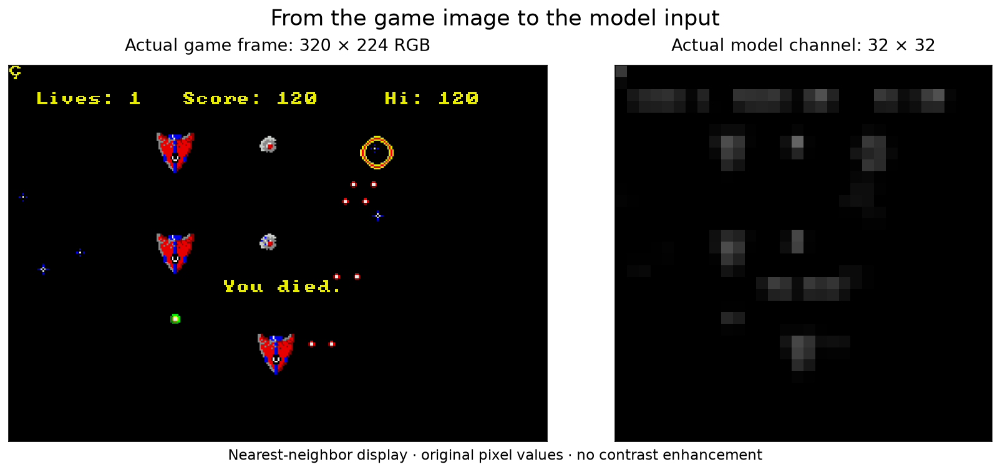
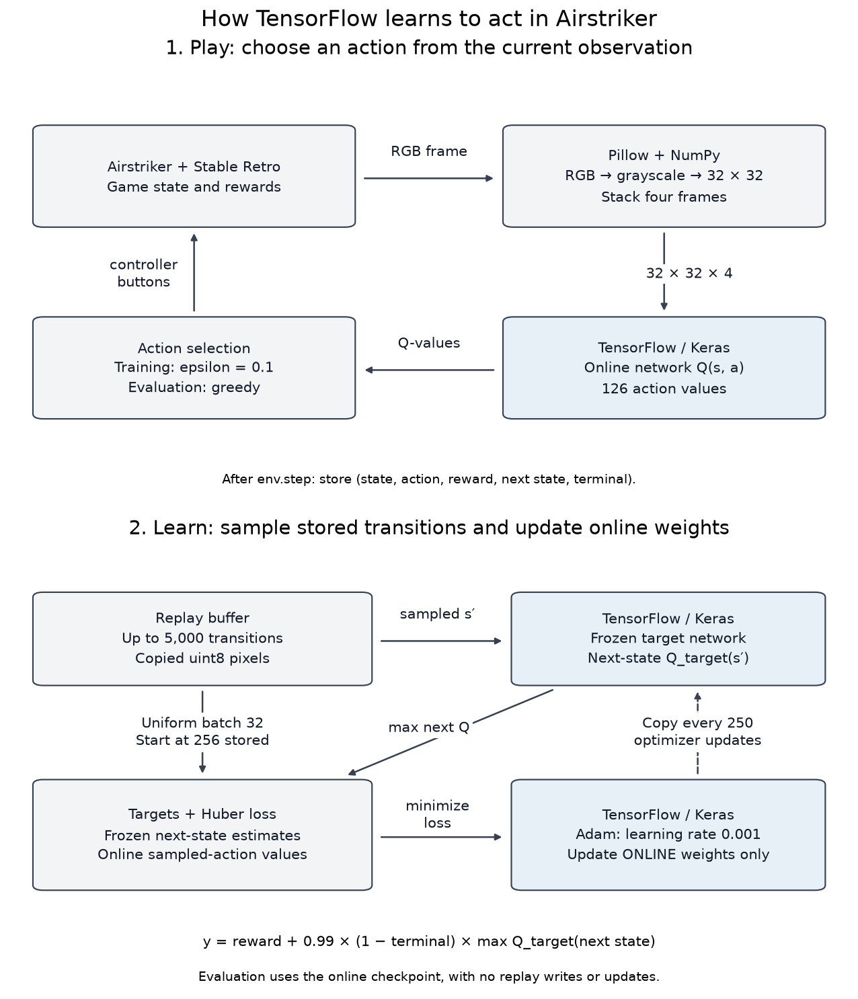

# Airstriker TensorFlow

[](https://github.com/kleberandrade/airstriker-tensorflow/actions/workflows/ci.yml)


[](LICENSE)

**Learn how reinforcement learning connects images, actions, rewards and a neural network.** This educational project uses TensorFlow/Keras to control **Airstriker**, a Sega Genesis shooter included with Stable Retro for non-commercial testing.


*Real DQN capture: seed 7, evaluation step 4,000, current-episode score 120. The full 6,000-step evaluation accumulated 640 across resets. All seeds, including the zero-score failure, are reported below.*

The project contains a working image pipeline, a small DQN with **uniform replay and a frozen target network**, bounded training, checkpoint evaluation, seeded comparisons and a recorder. **It is a learning baseline, not a solved-game agent.** The replay/target experiment trained three networks for 10,000 steps each. It improved the mean in this sample, while one seed still failed; the mixed outcomes are part of the lesson.

## Start here

1. [Run your first experiment](#install-and-run): install the tested environment and execute a short real-emulator run.
2. [Understand one decision](#how-one-decision-works): follow a frame through the network and back to the game.
3. [Work through the tutorial](docs/PROJECT_GUIDE.md): inspect real images, calculate a learning target and compare policies fairly.
4. [Read the replay/target experiment](docs/experiments/2026-11-16-airstriker-dqn/REPORT.md): screenshots, per-seed results, raw traces, provenance and limitations.

## Install and run

Use **CPython 3.13**, a 64-bit Linux or macOS Apple Silicon system and a TensorFlow-compatible CPU. The offline suite/build passed on Ubuntu; the real emulator experiment ran on Apple Silicon CPU. GPU, Intel macOS and native Windows are unverified.

```sh
git clone https://github.com/kleberandrade/airstriker-tensorflow.git
cd airstriker-tensorflow
python3.13 -m venv .venv
source .venv/bin/activate
python -m pip install --upgrade pip
python -m pip install -r requirements-dev.lock
python -m pip install --no-deps -e .
python -m pip check
```

The lock installs the complete tested environment, including Stable Retro and development tools. **The Airstriker test ROM is already supplied by Stable Retro**; no separate ROM download/import is needed. No ROM binary is committed here. See [upstream asset information](https://github.com/Farama-Foundation/stable-retro).

Run a short real experiment with random, untrained and checkpoint policies:

```sh
python examples/retro_experiment.py --output runs/first-airstriker-experiment
```

Default configuration: seeds 7/13/29, 512 training steps per seed, 256 evaluation steps per policy, RGB/processed captures every 128 steps. Choose a **new output directory** each time: existing evidence is protected from overwrite.

For a single model:

```sh
airstriker-tf train --env retro --steps 512 --seed 7 --checkpoint runs/airstriker.keras
airstriker-tf evaluate --env retro --steps 256 --seed 7 --checkpoint runs/airstriker.keras
```

The real environment defaults to `Airstriker-Genesis-v0`. Use `--state NAME` only when choosing an installed integration savestate. `airstriker-tf --help` lists all options.

If you only want to check the software without emulation:

```sh
python examples/smoke.py
```

That example uses an **explicitly synthetic test fixture** and a reduced four-transition warmup, collects eight steps and performs five replay updates, saves/reloads a temporary checkpoint and evaluates for eight steps. Its rewards are test data, not Airstriker results. For a smaller install without the emulator, use `python -m pip install -e .`; add `'.[retro]'` or `'.[dev,retro]'` as needed.

## How one decision works

1. **Observe:** Stable Retro returns the game's RGB image. In the recorded experiment this is 224×320×3 unsigned bytes.
2. **Prepare:** convert RGB to grayscale, resize to 32×32 and divide by 255. Stack four frames so movement can influence the decision.
3. **Predict:** a Keras network turns the `(32, 32, 4)` tensor into one Q-value per discrete controller action. Airstriker exposes 126 filtered button combinations.
4. **Act:** during training, choose a random action 10% of the time; otherwise choose the action with the largest predicted value. Evaluation always uses the largest value.
5. **Remember and learn:** save the transition in a bounded replay buffer. After 256 stored transitions, sample a 32-transition minibatch, update the online network using frozen target predictions, and synchronize the target every 250 optimizer updates.

The comparison below shows the actual game frame beside its 32×32 model channel. The pixels are enlarged with **nearest-neighbor rendering**, so they stay sharp instead of being blurred by the browser. Pixel intensities are unchanged; the dark, coarse appearance shows how much visual detail the model loses. It receives four consecutive channels.



[Open the exact 384×384 pixel enlargement](images/airstriker-observation-comparison-pixels.png). Its underlying data are still 32×32; enlargement does not recover missing detail.

### Where TensorFlow fits



[Open the scalable diagram](images/airstriker-dqn-flow.svg). Stable Retro executes the game and supplies rewards; Pillow/NumPy prepare observations. TensorFlow/Keras predicts action values with the online network and computes its weight updates from replay minibatches. The second network supplies frozen next-state estimates, receiving only periodic weight copies. Evaluation uses the online checkpoint and performs no learning.

The DQN target uses the frozen target network:

```text
target = reward + 0.99 × max(target-network next Q-values)       # continuing transition
target = reward                                # true terminal transition
```

For a reward of 2 and best predicted next value of 5, the continuing target is `2 + 0.99 × 5 = 6.95`. If the game truly ends, the target is 2. A time-limit truncation still bootstraps from its final frame. The [tutorial](docs/PROJECT_GUIDE.md) explains why these cases differ and why a model can change weights even when reward is zero.

## Replay + target network: measured comparison

We repeated the exact **seeds 7/13/29**, **10,000 training transitions per seed**, and **6,000 evaluation transitions per policy**. The CNN, Adam rate, discount, epsilon, observations, savestate and action space stayed fixed. New replay settings are capacity 5,000, minibatch 32, warmup 256 and target sync every 250 optimizer updates.

- Re-run random baseline: **300, 140, 300**; mean **246.67**.
- Re-run untrained network: **460, 0, 180**; mean **213.33**.
- Previous online learner: **0, 520, 120**; mean **213.33**.
- New replay/target DQN: **640, 0, 520**; mean **386.67**.

The new mean was **140 points above random** and **173.33 above the previous learner** in this three-seed sample. Two seeds beat random; seed 13 still earned zero and regressed from the previous learner. The re-run random and untrained traces matched the earlier controls byte-for-byte. These results show an improvement in this experiment, with substantial variation and no claim of statistical significance or unseen-level generalization.


[Read every result, failure, episode return, image and provenance record](docs/experiments/2026-11-16-airstriker-dqn/REPORT.md). The new run contains 84,000 real transitions, 312 native/processed gameplay PNGs, and complete/unfinished episode accounting. Historical evidence remains available for the [online learner](docs/experiments/2026-11-16-airstriker-long/REPORT.md) and [initial smoke](docs/experiments/2026-11-16-airstriker/REPORT.md).

Longer training is explicit and opt-in:

```sh
python examples/retro_experiment.py --output runs/airstriker-dqn-reproduction \
  --seeds 7 13 29 --train-steps 10000 --evaluate-steps 6000 --capture-every 1000 \
  --replay-capacity 5000 --batch-size 32 --learning-starts 256 --target-sync-interval 250
```

Regenerate the published analysis and algorithm comparison **without retraining**:

```sh
python -m pip install -e '.[report]'
python examples/analyze_experiment.py \
  --source docs/experiments/2026-11-16-airstriker-dqn \
  --previous docs/experiments/2026-11-16-airstriker-long \
  --output runs/dqn-report --window 1000
```

The protocol matches environment-step budgets, not compute: each new seed performs 9,745 minibatch updates (311,840 replay samples) and 38 target copies. The previous learner used 10,000 single-transition updates. Replay and target estimates changed together, so this experiment does not isolate their individual contributions.

## Python API

```python
from airstriker_tensorflow.agent import Agent
from airstriker_tensorflow.environments import DEFAULT_GAME, make_retro
from airstriker_tensorflow.training import run

env = make_retro(DEFAULT_GAME)
try:
    agent = Agent(env.action_count, seed=7)
    print(run(env, agent, steps=512, seed=7, training=True))
    agent.save("runs/airstriker.keras")
finally:
    env.close()
```

Default replay settings are capacity 5,000, batch size 32, learning starts 256, and target sync every 250 optimizer updates. Set `--replay-capacity`, `--batch-size`, `--learning-starts`, or `--target-sync-interval` explicitly to study a change. Below warmup, `loss` is `null` and optimizer updates are zero.

Training writes a `.keras` online-model checkpoint and the CLI writes an adjacent JSON run record including replay configuration and update counters. Evaluation checks action count and leaves model weights unchanged. Use the same game and integration/action mapping when loading a checkpoint. Online model/optimizer state is saved; replay contents, delayed target weights, emulator state, RNG state and frame history are not, so exact interrupted-training resumption is not supported.

## Project layout and checks

- `src/airstriker_tensorflow/`: environment, preprocessing, agent/model, training/evaluation, recording, experiment orchestration, trace analysis and CLI.
- `examples/`: executable synthetic smoke and real Airstriker comparison.
- `tests/`: offline behavior, error paths and explicitly labeled adapter-contract tests.
- `images/`: actual Airstriker screenshots and processed input used in this README.
- `docs/PROJECT_GUIDE.md`: practical teaching guide, API and experiment methodology.
- `docs/experiments/`: short and longer measured runs, gameplay images, compressed traces, plots and provenance.

```sh
ruff check src tests examples
ruff format --check src tests examples
pytest --cov=airstriker_tensorflow --cov-report=term-missing --cov-report=lcov
python examples/smoke.py
python -m build --no-isolation
```

[CI](https://github.com/kleberandrade/airstriker-tensorflow/actions/workflows/ci.yml) runs those offline checks on Ubuntu/Python 3.13. Offline tests use synthetic data to check frame semantics, seeds, terminal targets, actual TensorFlow updates, checkpoint loading, recording and cleanup. They do not stand in for the separate real-emulator experiment.

## Limits and license

This DQN uses uniform replay and a periodically copied target network. It has no prioritized replay, Double DQN, dueling head, frame skipping or tuned reward shaping. Short, correlated updates can be unstable. There is no solved level, full-episode benchmark, convergence result or generalization claim. Long training never runs by default.

TensorFlow 2.21 requires `h5py<3.15`; Stable Retro 1.0.1 requires `pyglet<2`. The lock preserves those constraints. Upstream Keras/NumPy serialization deprecation warnings and TensorFlow CPU-profiling diagnostics are recorded rather than suppressed. See [dependency evidence](docs/experiments/2026-11-16-airstriker/dependency-updates.json).

Project code is [MIT licensed](LICENSE), retaining the original copyright. Airstriker by Electrokinesis is supplied upstream as a non-commercial test ROM; game imagery retains its owners' rights and is not relicensed under MIT. Screenshots here document actual tests. No ROM or checkpoint is distributed. Stable Retro and its emulator cores retain [their separate licenses](https://github.com/Farama-Foundation/stable-retro/blob/main/LICENSES.md).
