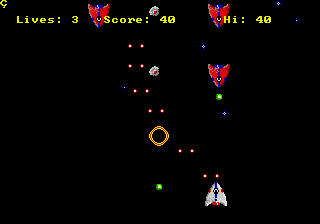
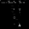

# Airstriker TensorFlow

[](https://github.com/kleberandrade/airstriker-tensorflow/actions/workflows/ci.yml)


[](LICENSE)

**Learn how reinforcement learning connects images, actions, rewards and a neural network.** This educational project uses TensorFlow/Keras to control **Airstriker**, a Sega Genesis shooter included with Stable Retro for non-commercial testing.



*Actual emulator capture: seed 13, evaluation step 256, score 40. A screenshot shows a game state; it does not establish that a policy has learned to play well.*

The project contains a working image pipeline, a small Q-network, bounded training, checkpoint evaluation, seeded comparisons and a recorder. **It is a learning baseline, not a solved-game agent.** The recorded 128-step training windows earned no positive rewards; later evaluation differences are exploratory.

## Start here

1. [Run your first experiment](#install-and-run): install the tested environment and execute a short real-emulator run.
2. [Understand one decision](#how-one-decision-works): follow a frame through the network and back to the game.
3. [Work through the tutorial](docs/PROJECT_GUIDE.md): inspect real images, calculate a learning target and compare policies fairly.
4. [Read the evidence](docs/experiments/2026-11-16-airstriker/REPORT.md): screenshots, per-seed results, raw traces, provenance and limitations.

## Install and run

Use **CPython 3.13**, a 64-bit Linux or macOS Apple Silicon system and a TensorFlow-compatible CPU. The offline suite/build passed on Ubuntu; the real emulator experiment ran on Apple Silicon CPU. GPU, Intel macOS and native Windows are unverified.

```sh
git clone https://github.com/kleberandrade/airstriker-tensorflow.git
cd airstriker-tensorflow
python3.13 -m venv .venv
source .venv/bin/activate
python -m pip install --upgrade pip
python -m pip install -r requirements-dev.lock
python -m pip install --no-deps -e .
python -m pip check
```

The lock installs the complete tested environment, including Stable Retro and development tools. **The Airstriker test ROM is already supplied by Stable Retro**; no separate ROM download/import is needed. No ROM binary is committed here. See [upstream asset information](https://github.com/Farama-Foundation/stable-retro).

Run a short real experiment with random, untrained and checkpoint policies:

```sh
python examples/retro_experiment.py --output runs/first-airstriker-experiment
```

Default configuration: seeds 7/13/29, 128 training steps per seed, 256 evaluation steps per policy, RGB/processed captures every 128 steps. Choose a **new output directory** each time: existing evidence is protected from overwrite.

For a single model:

```sh
airstriker-tf train --env retro --steps 128 --seed 7 --checkpoint runs/airstriker.keras
airstriker-tf evaluate --env retro --steps 256 --seed 7 --checkpoint runs/airstriker.keras
```

The real environment defaults to `Airstriker-Genesis-v0`. Use `--state NAME` only when choosing an installed integration savestate. `airstriker-tf --help` lists all options.

If you only want to check the software without emulation:

```sh
python examples/smoke.py
```

That example uses an **explicitly synthetic test fixture**, trains for eight steps, saves/reloads a temporary checkpoint and evaluates for eight steps. Its rewards are test data, not Airstriker results. For a smaller install without the emulator, use `python -m pip install -e .`; add `'.[retro]'` or `'.[dev,retro]'` as needed.

## How one decision works

1. **Observe:** Stable Retro returns the game's RGB image. In the recorded experiment this is 224×320×3 unsigned bytes.
2. **Prepare:** convert RGB to grayscale, resize to 32×32 and divide by 255. Stack four frames so movement can influence the decision.
3. **Predict:** a Keras network turns the `(32, 32, 4)` tensor into one Q-value per discrete controller action. Airstriker exposes 126 filtered button combinations.
4. **Act:** during training, choose a random action 10% of the time; otherwise choose the action with the largest predicted value. Evaluation always uses the largest value.
5. **Learn:** the emulator returns a reward and episode flags. Update the selected action's prediction using the reward plus a discounted estimate of future value.

The processed image below is one channel of the actual observation used for the gameplay capture above, enlarged by the browser. The model receives four consecutive channels, not this single image alone.



The Q-learning target is:

```text
target = reward + 0.99 × max(next Q-values)       # continuing transition
target = reward                                # true terminal transition
```

For a reward of 2 and best predicted next value of 5, the continuing target is `2 + 0.99 × 5 = 6.95`. If the game truly ends, the target is 2. A time-limit truncation still bootstraps from its final frame. The [tutorial](docs/PROJECT_GUIDE.md) explains why these cases differ and why a model can change weights even when reward is zero.

## What the recorded experiment actually found

Three seeds, 12 runs, **2,688 real transitions and 90 PNGs** were recorded:

- Random evaluation rewards: **0, 0, 0**.
- Untrained greedy network: **20, 0, 0**.
- Short training windows: **0, 0, 0**.
- Saved/reloaded checkpoint evaluation: **20, 40, 40**.

No complete episode finished. The sample is too small to establish a learning improvement, and the training windows received no positive reward. Treat this as evidence that the integration and measurement pipeline work. Inspect [the full report](docs/experiments/2026-11-16-airstriker/REPORT.md) before drawing performance conclusions.

## Python API

```python
from airstriker_tensorflow.agent import Agent
from airstriker_tensorflow.environments import DEFAULT_GAME, make_retro
from airstriker_tensorflow.training import run

env = make_retro(DEFAULT_GAME)
try:
    agent = Agent(env.action_count, seed=7)
    print(run(env, agent, steps=128, seed=7, training=True))
    agent.save("runs/airstriker.keras")
finally:
    env.close()
```

Training writes a `.keras` checkpoint and the CLI writes an adjacent JSON run record. Evaluation checks action count and leaves model weights unchanged. Use the same game and integration/action mapping when loading a checkpoint. Model/optimizer state is saved; emulator state, RNG state and frame history are not, so exact interrupted-training resumption is not supported.

## Project layout and checks

- `src/airstriker_tensorflow/`: environment, preprocessing, agent/model, training/evaluation, recording, experiment orchestration and CLI.
- `examples/`: executable synthetic smoke and real Airstriker comparison.
- `tests/`: offline behavior, error paths and explicitly labeled adapter-contract tests.
- `images/`: actual Airstriker screenshots and processed input used in this README.
- `docs/PROJECT_GUIDE.md`: practical teaching guide, API and experiment methodology.
- `docs/experiments/2026-11-16-airstriker/`: measured results, 90 PNGs, trace records and asset provenance.

```sh
ruff check src tests examples
ruff format --check src tests examples
pytest --cov=airstriker_tensorflow --cov-report=term-missing --cov-report=lcov
python examples/smoke.py
python -m build --no-isolation
```

[CI](https://github.com/kleberandrade/airstriker-tensorflow/actions/workflows/ci.yml) runs those offline checks on Ubuntu/Python 3.13. Offline tests use synthetic data to check frame semantics, seeds, terminal targets, actual TensorFlow updates, checkpoint loading, recording and cleanup. They do not stand in for the separate real-emulator experiment.

## Limits and license

This online one-step Q-learning baseline has no replay buffer, target network, frame skipping or tuned reward shaping. Short, correlated updates can be unstable. There is no solved level, full-episode benchmark, convergence result or generalization claim. Long training never runs by default.

TensorFlow 2.21 requires `h5py<3.15`; Stable Retro 1.0.1 requires `pyglet<2`. The lock preserves those constraints. Upstream Keras/NumPy serialization deprecation warnings and TensorFlow CPU-profiling diagnostics are recorded rather than suppressed. See [dependency evidence](docs/experiments/2026-11-16-airstriker/dependency-updates.json).

Project code is [MIT licensed](LICENSE), retaining the original copyright. Airstriker by Electrokinesis is supplied upstream as a non-commercial test ROM; game imagery retains its owners' rights and is not relicensed under MIT. Screenshots here document actual tests. No ROM or checkpoint is distributed. Stable Retro and its emulator cores retain [their separate licenses](https://github.com/Farama-Foundation/stable-retro/blob/main/LICENSES.md).
