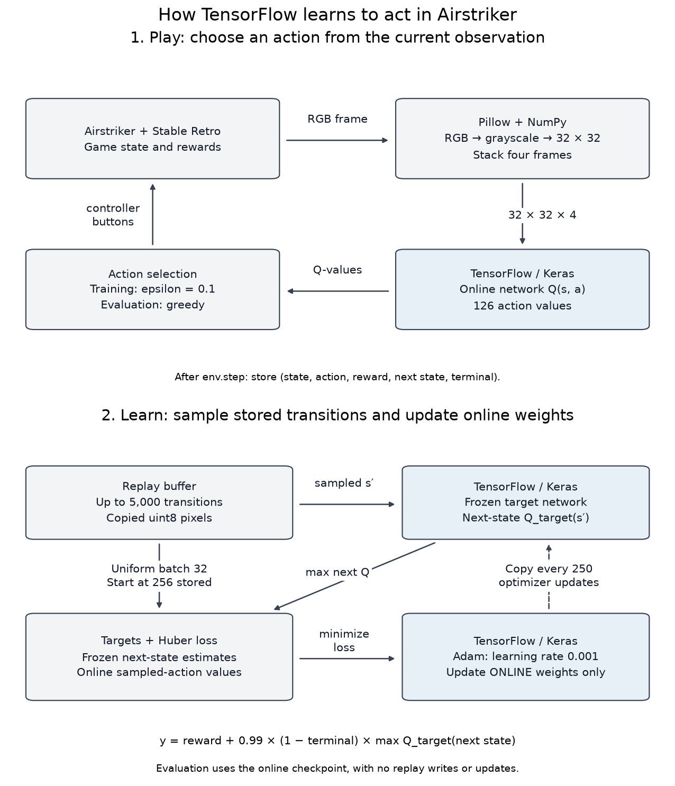
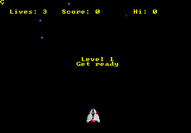
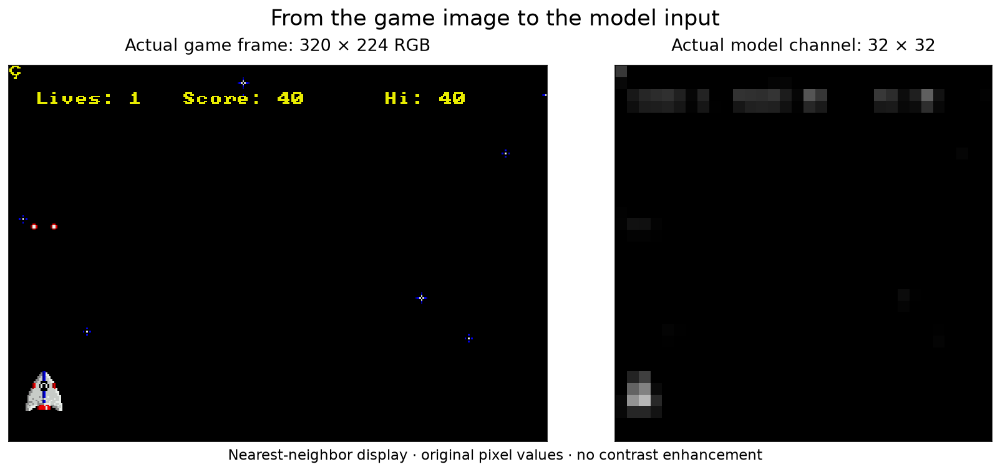
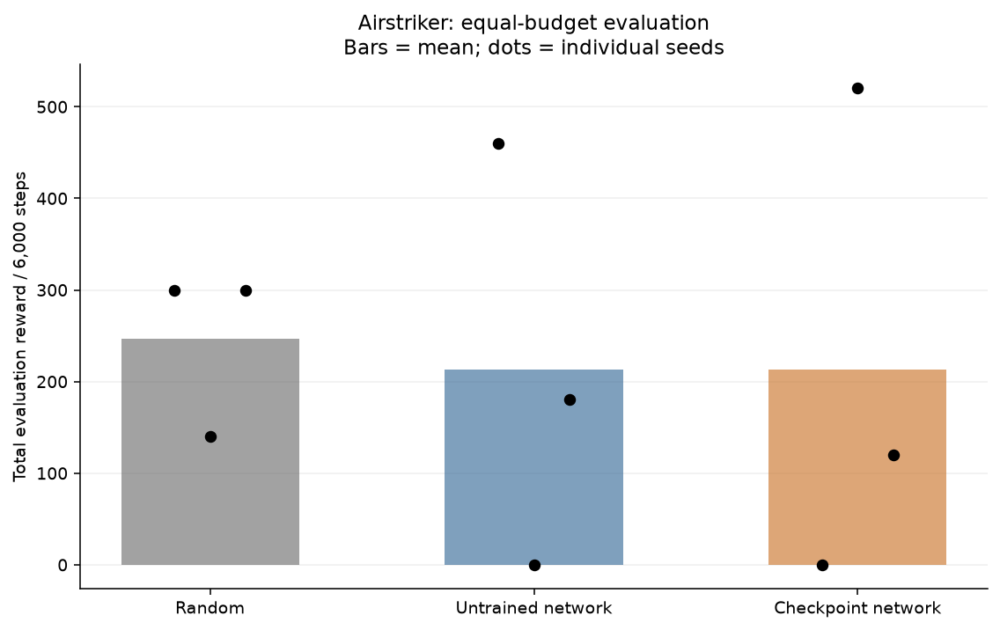

# Learn reinforcement learning with Airstriker

This guide is a practical walk through a complete loop: observe a real game, turn its image into numbers, choose a controller action, measure the reward and update a neural network. You will also learn how to check whether an experiment supports the conclusion you want to draw.

The game is **Airstriker by Electrokinesis**, a Sega Genesis shooter included with Stable Retro for non-commercial testing. The learning framework is **TensorFlow/Keras**. The recorded experiment establishes a working integration; it does not establish a strong playing policy.

## The two loops at a glance



[Scalable SVG](../images/airstriker-dqn-flow.svg). The top loop advances the real game. The bottom loop learns from stored transitions. TensorFlow executes the online and target networks and differentiates the online loss; Stable Retro supplies game observations/rewards and Pillow/NumPy prepare pixels. A dashed arrow represents a periodic weight copy, not a gradient update to the target network.

## 1. Set up a reproducible lab

Use Python 3.13 and follow the [README installation](../README.md#install-and-run). The complete development lock includes TensorFlow, Stable Retro, Pillow, NumPy and test/build tools.

```sh
python -m pip check
python examples/smoke.py
```

The smoke command uses a synthetic fixture, not the game. Its purpose is to check that a network can update, save and reload without needing an emulator. It should print two JSON objects: eight training steps and eight evaluation steps. A successful synthetic check is a prerequisite, not evidence of real-game performance.

Now inspect the real integration:

```python
from airstriker_tensorflow.environments import DEFAULT_GAME, make_retro

env = make_retro(DEFAULT_GAME)
try:
    frame, info = env.reset(seed=7)
    print(DEFAULT_GAME)       # Airstriker-Genesis-v0
    print(frame.shape)        # (224, 320, 3) in the recorded integration
    print(frame.dtype)        # uint8
    print(env.action_count)   # 126 filtered combinations in this integration
    print(env.buttons)        # Controller button names supplied by the emulator
finally:
    env.close()
```

The factory reads the action-space size from Stable Retro. Do not hardcode button indices for a different game or infer that action 1 always means “fire.” Discrete actions represent filtered button combinations, and their meaning belongs to the integration.

**Check your understanding:** why would using a checkpoint with a different controller mapping be unsafe even if both environments had 126 actions? The output neurons would refer to different actions. The loader checks output size, not semantic identity.

## 2. Learn the vocabulary

- **Environment:** emulator plus game state, rules, rewards and episode termination logic.
- **Observation:** information received by the agent. Here it is an RGB frame, not a complete description of the game's internal state.
- **Action:** one allowed controller-button combination.
- **Reward:** numerical feedback after an action. Airstriker's integration rewards increases in the `score` variable.
- **Episode:** interaction from reset until a true terminal or a time-limit truncation.
- **Policy:** rule for selecting an action. A random policy and an epsilon-greedy network policy are different policies.
- **Q-value:** the network's estimate of discounted future reward from a state/action pair. It is neither a probability nor the displayed game score.
- **Seed:** an initialization value for pseudorandom choices. It helps repeat local conditions; it does not guarantee identical execution on every machine.
- **Checkpoint:** saved model and optimizer state. It is not a complete saved emulator/training session.

A displayed death message is not automatically an episode boundary. This integration's true terminal requires both `gameover == 1` and `lives == 0`. The recorded short runs did not complete an episode.

## 3. Turn pixels into model input



The recorded native observation has shape `(224, 320, 3)`: height, width and RGB channels. Each channel is an unsigned byte from 0 to 255. A raw frame is expensive to process and a single image cannot reliably describe movement.

`FrameStack` makes four decisions:

1. Validate that the input is a three-channel uint8 image. Reject malformed data at the boundary.
2. Convert RGB to grayscale and resize to 32×32. This reduces cost but also discards color and small-object detail.
3. Divide by 255 to get float32 values in [0, 1]. Normalization changes the numerical scale, not the game.
4. Stack four consecutive processed frames. The result has shape `(32, 32, 4)` and carries a small amount of motion history.

```python
from airstriker_tensorflow.preprocessing import FrameStack

stack = FrameStack()
state = stack.reset(frame)
print(state.shape, state.dtype)  # (32, 32, 4), float32
print(state.min() >= 0, state.max() <= 1)  # True True
```

`frame` above is the observation obtained in lesson 1. This snippet performs no new emulator interaction. At reset, all four channels are filled with the first frame. The first new observation shifts the oldest channel out. Resetting clears history so an earlier episode cannot leak into the next.



[Open the exact 12× nearest-neighbor enlargement](../images/airstriker-100k-observation-comparison-pixels.png). Pixel values are not brightened or contrast-adjusted.

The right panel is one real processed channel, enlarged without smoothing; the left panel preserves the original game frame. The full stack contains four channels. The aggressive downsampling is a teaching simplification: an agent may struggle because useful visual detail is missing, even when its code is correct.

**Try it:** inspect the raw and processed images side by side. Identify a small object that becomes harder to distinguish. Write down which information you would preserve before increasing model complexity.

## 4. Follow the Q-network

The architecture in `agent.py` is deliberately small:

1. Input `(32, 32, 4)`.
2. Eight convolution filters, kernel 5×5, stride 4, ReLU activation. Output: `(7, 7, 8)`.
3. Flatten to 392 values.
4. Dense layer: 32 ReLU units.
5. Linear output: one Q-value per environment action.

With 126 actions, this is **17,542 trainable parameters**. The linear outputs can be positive or negative; no softmax is applied because Q-values are value estimates rather than probabilities.

```python
from airstriker_tensorflow.agent import Agent

agent = Agent(126, seed=7)
values = agent.values(state)
print(values.shape)          # (126,)
print(agent.act(state, 0.0)) # Index of the largest predicted Q-value
```

Use the environment's actual `action_count` in application code; 126 is shown here only to match the measured Airstriker integration. Calling the policy does not advance the game. Only `env.step(action)` changes the environment.

## 5. Calculate one learning target by hand

Suppose the selected action earns reward 2 and the best frozen-target next Q-value is 5. With discount factor gamma = 0.99:

```text
continuing target = 2 + 0.99 × 5 = 6.95
true terminal target = 2
```

Try the actual target function:

```python
from airstriker_tensorflow.agent import bootstrap_targets

print(bootstrap_targets([2.0], [False], [[1.0, 5.0]], 0.99))  # [6.95]
print(bootstrap_targets([2.0], [True], [[1.0, 5.0]], 0.99))   # [2.]
```

Floating-point arithmetic may display the continuing result as `6.95000005`; it represents the same target to numerical precision.

A true terminal means there are no later game rewards to predict. A time-limit truncation means collection stopped even though the underlying game could continue, so the final observation still permits bootstrapping.

The current implementation stores transitions and samples 32 of them uniformly for each update after warmup. It copies online predictions, replaces the chosen actions' targets using the frozen target network, and performs one Keras update with Huber loss and Adam learning rate 0.001. Lesson 12 explains the replay and target lifecycle. A decreasing loss can mean that the network is matching its own estimates more closely; it does not by itself mean better gameplay.

**Important consequence:** if reward is zero, the target can still differ from the current prediction because the best next Q-value is nonzero. Weights can change without positive rewards. That happened in every recorded training window. Do not report a weight change as proof of successful reward-driven learning.

## 6. Separate exploration from evaluation

Training uses epsilon = 0.1: approximately 10% of decisions select a random action, while the rest select the largest Q-value. Evaluation uses epsilon = 0 and is greedy. Randomness does not guarantee useful exploration, particularly with 126 actions and a short interaction budget.

```sh
airstriker-tf train --env retro --steps 512 --seed 7 --checkpoint runs/airstriker.keras
airstriker-tf evaluate --env retro --steps 256 --seed 7 --checkpoint runs/airstriker.keras
```

The CLI defaults to `Airstriker-Genesis-v0`. The Airstriker test ROM comes with Stable Retro. `--state NAME` selects an installed savestate; otherwise the integration starts from its default `Level1` state. There is no automatic fallback to synthetic observations if emulation fails.

`--steps` is a positive hard limit. Training starts a new network and saves a `.keras` model plus neighboring JSON run record. Evaluation loads the checkpoint, verifies action count and does not change weights. JSON includes the seed, game/state, environment kind, step count, completed episodes, total reward and training loss (`null` for evaluation).

A checkpoint is not a trained expert. With default settings, fewer than 256 collected steps perform no optimizer update; a 512-step training run performs 257 minibatch updates. Inspect the counters instead of inferring training progress from the filename.

## 7. Compare policies with controls

```sh
python examples/retro_experiment.py \
  --output runs/airstriker-experiment \
  --seeds 7 13 29 \
  --train-steps 512 \
  --evaluate-steps 256 \
  --capture-every 128
```

Use a fresh output directory: the runner refuses to overwrite earlier evidence. For each seed, it performs four phases:

1. **random:** uniformly sample action indices, providing a baseline that does not use the network.
2. **untrained:** evaluate a newly initialized network greedily.
3. **train:** initialize a fresh network with the same seed and execute epsilon-greedy updates.
4. **trained:** reload that saved checkpoint and evaluate greedily.

All phases reset the same game/default savestate/seed. This makes starting conditions comparable. Multiple seeds expose sensitivity to initialization; three seeds are still too few for a robust conclusion.

The original 128-step smoke experiment recorded rewards for seeds 7/13/29 as random `[0, 0, 0]`, untrained `[20, 0, 0]`, training `[0, 0, 0]`, and checkpoint evaluation `[20, 40, 40]`. No episode finished. These numbers validate collection and comparison, but cannot establish convergence or reliable skill.

**Exercise:** imagine reporting only the checkpoint scores. What would readers miss? They would not know that an untrained network already earned points, the training windows earned none, and no complete episode finished. Baselines and negative results prevent misleading conclusions.

## 8. Read the evidence rather than trusting a screenshot

Each phase writes `transitions.jsonl`. Reset records identify the seed; step records contain action, reward, terminal flags and integration variables. A capture is sampled at reset, step 1 and each configured interval.

```python
import json
from pathlib import Path

trace = Path("runs/airstriker-experiment/seed-7-trained/transitions.jsonl")
records = [json.loads(line) for line in trace.read_text().splitlines()]
steps = [row for row in records if row["event"] == "step"]
print(len(steps), sum(row["reward"] for row in steps))
print(steps[-1]["info"])
```

The manifest summarizes versions, platform, configuration, elapsed rollout time, total reward, loss, action histogram, nonzero rewards, terminal counts, final integration variables and image paths. Completed seeds are saved even if a later seed fails. Timing includes inference/updates, trace writes and screenshots, but excludes model construction/loading and final checkpoint saving; it is not a controlled throughput benchmark.

The [recorded report](experiments/2026-11-16-airstriker/REPORT.md) includes native images, input previews, raw traces and asset/source/artifact hashes. Its provenance describes the source bytes used when that experiment was recorded. A later package rename does not rewrite historical measurements or claim those hashes describe the current source tree.

## 9. Understand the code boundaries

- `environments.py`: `DEFAULT_GAME`, explicit synthetic fixture, optional Stable Retro factory.
- `preprocessing.py`: observation validation and temporal input representation.
- `agent.py`: DQN configuration, online/frozen networks, policy, targets, updates and checkpoints.
- `replay.py`: seeded uniform replay, compact copied observations and minibatch reconstruction.
- `training.py`: bounded interaction loop shared by training and evaluation.
- `cli.py`: parsing, metadata and guaranteed environment cleanup.
- `recording.py`: transparent wrapper that saves exact observations and trace events.
- `experiment.py`: reproducible control policies and multi-seed orchestration.
- `analysis.py`: audited reward totals, complete-episode returns, unfinished tails and fixed-step windows.
- `analysis.py`: checked trace accounting, completed/unfinished episodes, reward windows and seed comparisons.
- `examples/`: runnable offline smoke and real-emulator comparison.
- `tests/`: offline behavior and error cases. Synthetic fixtures and factory replacements are explicitly labeled.

The environment contract is `reset(seed=...) -> (image, info)`, `step(action) -> (image, reward, terminated, truncated, info)`, and `close()`. The runner resets on either terminal flag and increments the episode seed. Keep the terminal observation for its learning update before resetting.

A complete API loop is:

```python
from airstriker_tensorflow.agent import Agent
from airstriker_tensorflow.environments import DEFAULT_GAME, make_retro
from airstriker_tensorflow.training import run

env = make_retro(DEFAULT_GAME)
try:
    agent = Agent(env.action_count, seed=7)
    print(run(env, agent, steps=512, seed=7, training=True))
    agent.save("runs/api-airstriker.keras")
    print(run(env, agent, steps=256, seed=7, training=False))
finally:
    env.close()
```

No replay contents, delayed target weights, environment/RNG state or frame history are restored from a checkpoint. A loaded agent initializes a fresh target copy and empty replay; checkpoints support inference, not exact training resumption. Use checkpoints for evaluation with the same game/action mapping, not exact interrupted-training recovery.

## 10. Verify a change and plan the next experiment

```sh
ruff check src tests examples
ruff format --check src tests examples
pytest --cov=airstriker_tensorflow --cov-report=term-missing --cov-report=lcov:target/coverage/python/lcov.info
python examples/smoke.py
python -m pip check
python -m build --no-isolation
```

Offline tests check normalized frame order/reset, seeds, terminal targets, real TensorFlow weight updates, checkpoint roundtrips, evaluation immutability, exact recorded PNG pixels, JSON serialization, invalid configuration and cleanup. They do not emulate Airstriker. The separately recorded real experiment provides integration evidence.

[GitHub Actions](https://github.com/kleberandrade/airstriker-tensorflow/actions/workflows/ci.yml) runs offline tests, lint, formatting, synthetic smoke and package builds on Ubuntu/Python 3.13. Real-emulator validation took place on Apple Silicon CPU. GPU, native Windows and Intel macOS remain unverified. Seeds do not guarantee bit-identical outputs across hardware or package versions.

Before adding complexity, state a hypothesis and change one factor. Useful follow-ups include preserving more visual detail, collecting longer episodes, testing a justified smaller action set, or running controlled ablations of replay capacity and target-update schedules. Compare against the same baselines and record failures. Longer training is an explicit experiment, never a default command.

**Questions to answer before claiming improvement:**

- Did evaluation use new episodes or only the same initial scene?
- Did all policies receive the same step budget and starting conditions?
- Were there enough seeds and completed episodes?
- Did reward increase during training, and is evaluation improvement reproducible?
- Could a change in preprocessing, action mapping or checkpoint loading explain the result?

## 11. Learn from a longer run that does not beat random

More training steps are a resource budget, not a guarantee of improvement. We trained fresh models for 10,000 steps each (seeds 7/13/29), leaving the small online Q-learning algorithm unchanged. Random, untrained and checkpoint policies each received 6,000 evaluation steps from the same default savestate.

The random rewards were `[300, 140, 300]`; checkpoint rewards were `[0, 520, 120]`. Their means were 246.67 and 213.33 respectively. The untrained-network mean was also 213.33. One successful seed therefore does not justify claiming that longer training beat the baseline.



During training, the three models collected 860, 920 and 900 points. Seed 7 nevertheless chose the same action on every greedy evaluation step and earned zero. Exploration during training and a greedy saved policy are different behaviors. Positive training reward, changing weights and finite loss diagnostics are insufficient evidence of good evaluation performance.

A fixed 6,000-step budget can contain several complete episodes and an unfinished final episode. The headline total includes both. Seed 13's 520 checkpoint points all belonged to an unfinished episode, so its mean **completed-episode** return is undefined. Treating that value as a complete-episode result would mislead readers.

Read the [full longer-run report](experiments/2026-11-16-airstriker-long/REPORT.md) for every episode return, unfinished tail, source hashes, action histograms, new screenshots and training windows. There are only three seeds and one starting savestate; no statistical significance or unseen-state generalization is asserted.

Regenerate the analysis from the committed compressed traces:

```sh
python -m pip install -e '.[report]'
python examples/analyze_experiment.py \
  --source docs/experiments/2026-11-16-airstriker-long \
  --output runs/long-report --window 1000
```

The analyzer rejects mismatches between raw trace totals and the manifest. It reads `.jsonl` and `.jsonl.gz`, separates complete episodes from the unfinished tail, and produces `analysis.json` plus PNG/SVG figures. It does not interact with the emulator. Matplotlib is optional for runtime users and included in the development lock. On restricted systems, set `MPLCONFIGDIR` and `XDG_CACHE_HOME` to writable directories.

**Exercise:** compare all three differences, `[-300, +380, -180]`, before reading the mean. What happens to your conclusion if you publish only seed 13? You hide two losses and falsely imply consistency. Decide on the seed/budget protocol before looking at the results, then report failures alongside successes.

This lesson describes the recorded online baseline from version 0.3.0; current training uses the DQN lifecycle in lesson 12. The original smoke scores used only 256 evaluation steps; the new totals use 6,000. Comparing their raw totals as if they were equal-budget performance would be invalid. A useful next experiment should change one justified factor, such as replay, target estimates or visual detail, while keeping the evaluation protocol fixed. Do not quietly tune after seeing these results and label the new outcome as the same experiment.

## 12. Why replay and a target network change the update

The current agent uses the two mechanisms introduced in [Mnih et al., Human-level control through deep reinforcement learning (2015)](https://doi.org/10.1038/nature14236). This is a small educational DQN, with a different game, network and budget; it is not a reproduction of that paper's Atari results.

**Replay buffer:** store `(state, action, reward, next_state, terminated)` after each game step, keeping the most recent 5,000 transitions. Observations are copied into uint8 pixel arrays so later frame changes cannot alter stored experience. Each state pair occupies 8,192 pixel bytes; a full buffer uses 40,960,000 pixel bytes (about 39.1 MiB), excluding Python/model/optimizer overhead. Sampling decodes float32 observations in [0, 1].

A seeded sampler draws 32 distinct transitions uniformly within a minibatch. A transition can be sampled again in a later batch. Its random generator is separate from the action-selection generator. Replay reuses past experience and reduces immediate temporal correlation; it does not guarantee that stored experience is useful or unbiased.

**Warmup:** no optimizer update occurs until 256 transitions are stored. The 256th transition permits the first update. A 10,000-step run therefore performs `10000 - 256 + 1 = 9745` updates. A short run below warmup collects experience, returns `loss = null`, and reports zero updates. The synthetic smoke uses smaller settings explicitly so eight collection steps actually exercise learning.

**Target network:** initialize a frozen copy of the online network. Compute sampled next-state values with that frozen copy:

```text
y = reward + 0.99 × (1 − true_terminal) × max Q_target(next_state)
loss = Huber(y, Q_online(sampled_state, sampled_action))
```

Adam changes only online weights. After every 250 optimizer updates, copy online weights to the target. This interval is measured in optimizer updates, not environment frames or episodes. The target stays unchanged between copies. A 9,745-update run makes 38 target copies; evaluation uses the final online checkpoint.

The online network still has 17,542 trainable parameters for Airstriker. The target holds another 17,542 frozen parameters. We retain the original convolutional architecture, Adam rate 0.001, gamma 0.99, epsilon 0.1, image representation and 126-action mapping. This is standard max-target DQN, with no Double DQN or prioritized replay.

Configuration is explicit:

```python
from airstriker_tensorflow.agent import Agent, DQNConfig

config = DQNConfig(replay_capacity=5000, batch_size=32,
                   learning_starts=256, target_sync_interval=250)
agent = Agent(126, seed=7, config=config)
print(agent.updates, agent.target_syncs, len(agent.replay))  # 0 0 0
```

The corresponding CLI options are `--replay-capacity`, `--batch-size`, `--learning-starts` and `--target-sync-interval`. Invalid settings fail before opening an emulator. Requirements are positive values and `batch_size <= learning_starts <= replay_capacity`.

**What the controlled run found:** DQN evaluation rewards `[640, 0, 520]` averaged 386.67, compared with random `[300, 140, 300]` (246.67) and the earlier online learner `[0, 520, 120]` (213.33). Random and untrained controls were independently re-run and their raw traces reproduced exactly. Two DQN seeds improved against random; the other remained a zero-score failure. The [complete report](experiments/2026-11-16-airstriker-dqn/REPORT.md) includes every seed and new images.

The environment budgets match, while optimizer compute does not: the new run samples 311,840 replay transitions per seed in 9,745 batches, versus 10,000 single-transition updates before. Replay and target networks were introduced together, so we cannot attribute the effect to one mechanism alone. There are only three training seeds and the same fixed savestate. Repeated deterministic episodes are not additional independent trials or unseen-level tests.

Batch metrics are reset before each optimizer update, so the new `loss` field averages actual returned minibatch losses. The old learner averaged running Keras metric values. Reward comparisons use equal-budget evaluations; comparing the two loss fields as convergence measures would be invalid.

Online model/optimizer state is saved in `.keras`. Replay contents and the delayed target state are not saved: loading initializes fresh replay and a target copy of online weights. This supports evaluation, not exact training continuation. A model saved before its first optimizer update can emit a Keras optimizer-slot warning on load; checked inference weights remain intact, and no warning is suppressed.

**Exercise:** predict the counters after 512 collection steps with default settings: 257 optimizer updates and one target copy. Explain why a target copied every 250 episodes would implement a different algorithm.

## 13. Test a larger training budget without changing the evaluation

A 100,000-step training run asks a different question from a new algorithm: does **more experience under the same DQN configuration** improve the final policy? Keep seeds 7/13/29, replay 5,000, batch 32, warmup 256, target sync every 250 updates, the same network/optimizer and the same default game state. Evaluate every policy for 6,000 steps.

Start fresh seeded models for 100,000 **total** training transitions per seed. This is not 100,000 additional steps after an incomplete checkpoint restore: the saved inference checkpoint omits replay, delayed target and RNG state. Fresh deterministic runs let you audit whether the first 10,000 recorded transitions reproduce the earlier experiment.

Expected counters per seed are `100000 - 256 + 1 = 99745` optimizer updates and `99745 // 250 = 398` target copies. The replay pixel allocation stays at 40,960,000 bytes when full; it does not grow to 100,000 transitions. This is a statement about stored pixel arrays, not measured process peak memory.

```sh
python examples/retro_experiment.py --output runs/airstriker-100k-reproduction \
  --seeds 7 13 29 --train-steps 100000 --evaluate-steps 6000 --capture-every 1000 \
  --replay-capacity 5000 --batch-size 32 --learning-starts 256 --target-sync-interval 250
```

The experiment has 300,000 training transitions and 54,000 evaluation/control transitions across 12 runs. Re-run random and untrained controls rather than assuming their old results. Compare the raw traces and the first 10,000-step training prefixes as reproducibility checks. A matching prefix verifies recorded behavior; it is not a direct hash of intermediate model parameters.

For this comparison, use the analyzer's explicit training-budget mode. The default algorithm-comparison mode still requires equal training budgets, preventing accidental apples-to-oranges reports. Training-budget mode requires the same game, seeds, evaluation length, algorithm and replay configuration, and rejects incomplete seed cohorts.

The primary endpoint is total reward per **6,000 evaluation steps**, including any unfinished tail. Total reward during 100,000 training steps is not comparable to the total during only 10,000 as a measure of policy quality. Training-window curves are exploratory diagnostics, not intermediate greedy evaluations. Only the earlier 10,000 endpoint and the new 100,000 endpoint are evaluated by this protocol.

**Exercise:** if a seed gets more reward during longer epsilon-greedy training but less reward in its final greedy evaluation, which result answers whether the final policy improved? Use the matched greedy evaluation. Then inspect all seeds and the unfinished tails before explaining a possible cause. More steps alone are not a guarantee, and one high score is not evidence of reliable generalization.

**Measured outcome:** the 100k DQN scored `[180, 420, 1120]`, mean **573.33**, versus 10k `[640, 0, 520]`, mean **386.67**, and random `[300, 140, 300]`, mean **246.67**. See [the full budget study](experiments/2026-11-16-airstriker-dqn-100k/REPORT.md) for all episodes, new images and plots. All six controls and three first-10k training prefixes reproduced byte-for-byte.

**Exercise:** calculate each seed's 100k-minus-10k difference before looking at the mean. Does more total training reward imply a better greedy policy? Explain using the equal 6,000-step evaluation returns rather than unequal training totals. A low minibatch loss alone does not demonstrate a useful policy.

## Toolchain, troubleshooting and rights

The supported interpreter is CPython 3.13. Direct pins are TensorFlow 2.21.0, NumPy 2.5.5, Pillow 13.0.0 and optional Stable Retro 1.0.1. Test/build pins and all transitive requirements are in `requirements-dev.lock`. TensorFlow constrains h5py to `<3.15.0`; Stable Retro constrains pyglet to `<2`. Forcing their newest incompatible releases is not an upgrade strategy. [Dependency evidence](experiments/2026-11-16-airstriker/dependency-updates.json) records the checked versions.

If an import fails, verify that your virtual environment is active and that `python -m pip show airstriker-tensorflow` refers to this checkout. If the ROM is missing, verify the installed Stable Retro package and `Airstriker-Genesis-v0` integration; do not substitute synthetic data. If a run refuses an existing directory, choose a new output path. If checkpoint output size differs, use a matching integration and regenerate the checkpoint. Upstream Keras/NumPy serialization warnings and TensorFlow CPU-profiling diagnostics are recorded, not suppressed.

The source package is `airstriker_tensorflow`, distribution is `airstriker-tensorflow`, and command is `airstriker-tf`. Earlier unsupported desktop experiments and unrelated screenshots were removed from the active tree; Git history preserves prior versions. The current workflow requires no desktop window title, keyboard injection or manual screenshot permission.

Project source code remains MIT with the original copyright. Airstriker imagery/ROM content retains its owners' rights. The ROM is supplied upstream for non-commercial tests; no public-domain status or MIT relicensing is inferred. No ROM or checkpoint is committed. Stable Retro and emulator cores retain [their own licenses](https://github.com/Farama-Foundation/stable-retro/blob/main/LICENSES.md).
