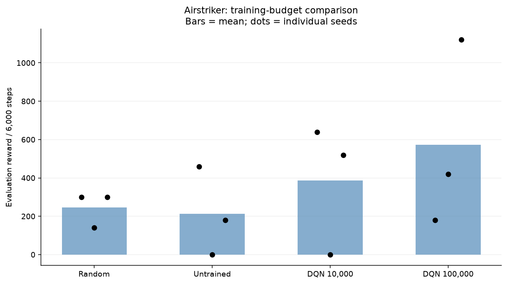
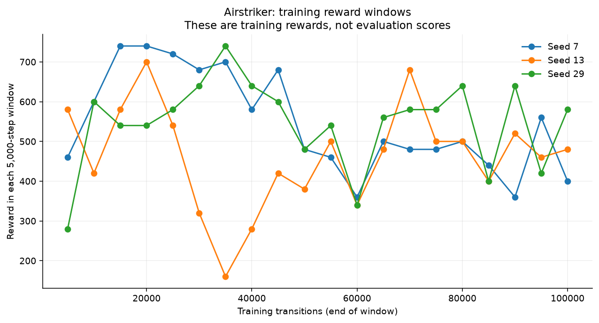
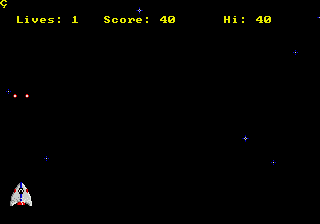
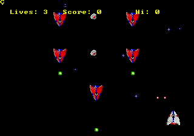
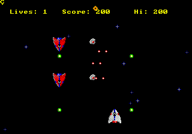
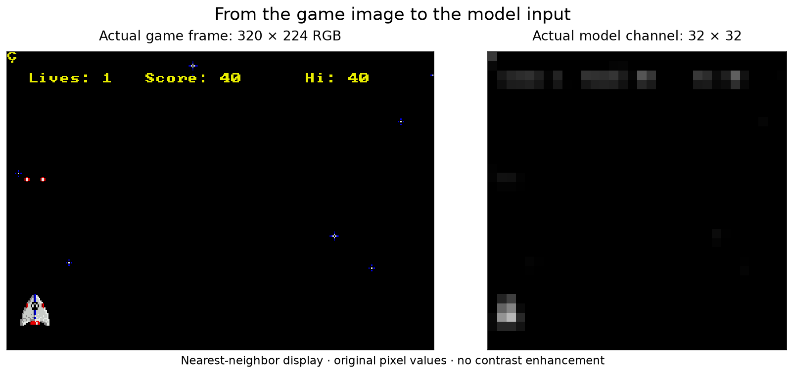

# DQN training budget: 100,000 versus 10,000 steps — 2026-11-16

## Observed result

The **100,000-step DQN** earned **180, 420, 1120** points for seeds 7/13/29 in equal **6,000-step evaluations**. The **10,000-step DQN** earned **640, 0, 520**. The re-run **random baseline** earned **300, 140, 300**.

Mean evaluation returns were **573.33 (100k DQN)**, **386.67 (10k DQN)**, and **246.67 (random)**. The descriptive differences are **+186.67 points versus 10k** and **+326.67 versus random**.

The 100k checkpoint beat its corresponding random baseline in **2/3 seeds** and beat the 10k checkpoint in **2/3**. This is a small same-savestate study, not a significance test, convergence proof or unseen-state evaluation. Every seed and failure is retained.



Bars are means and dots are individual training seeds, not confidence intervals. [SVG version](training-budget-comparison.svg).

## Protocol: only the training budget changes

- Fresh seeded models: **7, 13, 29**. Each receives **100,000 total training transitions**, not 100,000 additional transitions after loading an inference checkpoint.
- Evaluation remains **6,000 transitions per policy/seed**, including any unfinished final episode. Random and untrained controls are re-run.
- Same `Airstriker-Genesis-v0`, default `Level1` savestate, 32×32 grayscale/four-frame observations, 126 discrete actions and 17,542 trainable online parameters.
- Same replay capacity 5,000; batch 32; learning starts 256; frozen-target synchronization every 250 optimizer updates; Adam 0.001; gamma 0.99; training epsilon 0.1 and greedy evaluation.
- Same eight training/core source files, verified against the earlier experiment; unchanged TensorFlow/NumPy/Pillow/Stable Retro runtime versions. Reporting tools changed separately.
- **99,745 optimizer updates**, **398 target copies**, and **3,191,840 replay samples** per training seed. Replay ends at 5,000 entries/40,960,000 pixel bytes; this excludes model/Python/optimizer overhead and is not a peak-process-memory measurement.
- **354,000 total transitions:** 300,000 training plus 54,000 evaluation/control transitions. CPU on macOS Apple Silicon; no cloud/GPU run or new asset acquisition.

### Reproducibility checks

All **6/6** random/untrained control traces matched their earlier traces byte-for-byte. All **3/3** first-10,000-step training prefixes matched the shorter experiment. [Control hashes](control-reproduction.json), [training-prefix hashes](training-prefix-reproduction.json). Matching prefixes verify recorded behavior, not direct equality of unrecorded intermediate model parameters.

An inference checkpoint omits replay, delayed target state and RNG/frame history. Fresh same-seed reruns avoid falsely treating an incomplete restore as exact training continuation. The source/configuration protocol was frozen before this run; no parameters or stopping budget were changed after observing the first seed.

## Reproduce training and analysis

```sh
python examples/retro_experiment.py \
  --output runs/airstriker-100k-reproduction \
  --seeds 7 13 29 --train-steps 100000 --evaluate-steps 6000 --capture-every 1000 \
  --replay-capacity 5000 --batch-size 32 --learning-starts 256 --target-sync-interval 250
```

Use a new output directory. This is deliberately expensive relative to the small default example. It saves local per-seed checkpoints at the end of training; the current implementation does not provide exact mid-run recovery.

Regenerate the published accounting and figures without training:

```sh
python -m pip install -e '.[report]'
python examples/analyze_experiment.py \
  --source docs/experiments/2026-11-16-airstriker-dqn-100k \
  --previous docs/experiments/2026-11-16-airstriker-dqn \
  --comparison training-budget --output runs/100k-report --window 5000
```

The explicit training-budget mode requires matching game, seeds, evaluation length, algorithm and replay configuration. It rejects incomplete cohorts. The default algorithm-comparison mode continues to require equal training budgets.

## Every seed

### Seed 7

- Random **300**; untrained **460**; DQN 10k **640**; DQN 100k **180**.
- 100k minus 10k: **-460**; 100k minus random: **-120**.
- Training reward: 10920; completed training episodes: 60; diagnostic mean minibatch loss: 0.011650244548242449.
- Evaluation: 2 completed episodes; returns [80.0, 80.0]; lengths [2519, 2519]; unfinished tail `{"return": 20.0, "length": 962}`.
- Greedy evaluation used 24 distinct actions. Final integration variables: `{"gameover": 9, "lives": 2, "score": 20}`.

### Seed 13

- Random **140**; untrained **0**; DQN 10k **0**; DQN 100k **420**.
- 100k minus 10k: **+420**; 100k minus random: **+280**.
- Training reward: 9240; completed training episodes: 57; diagnostic mean minibatch loss: 0.003147642238579027.
- Evaluation: 1 completed episode; returns [260.0]; lengths [3759]; unfinished tail `{"return": 160.0, "length": 2241}`.
- Greedy evaluation used 9 distinct actions. Final integration variables: `{"gameover": 9, "lives": 1, "score": 160}`.

### Seed 29

- Random **300**; untrained **180**; DQN 10k **520**; DQN 100k **1120**.
- 100k minus 10k: **+600**; 100k minus random: **+820**.
- Training reward: 10920; completed training episodes: 61; diagnostic mean minibatch loss: 0.03767075075942147.
- Evaluation: 4 completed episodes; returns [280.0, 280.0, 280.0, 280.0]; lengths [1482, 1482, 1482, 1482]; unfinished tail `{"return": 0.0, "length": 72}`.
- Greedy evaluation used 13 distinct actions. Final integration variables: `{"gameover": 9, "lives": 3, "score": 0}`.

Seed-population standard deviations for the fixed-budget totals: 100k **398.78**, 10k **277.77**, random **75.42**. These describe this sample, not confidence in a general performance claim.

## Training windows



[SVG version](training-rewards.svg). Each point sums **5,000 training transitions**. These are epsilon-greedy training rewards, not intermediate greedy evaluations. The earlier report used smaller windows; raw window totals have different denominators. Only the 10k and 100k final checkpoints are evaluated by this comparison.

Longer training can accumulate more total points simply because it interacts longer. The matched 6,000-step evaluation, rather than total training reward or loss, answers whether its final policy improved. Repeated episodes from the same fixed savestate are not independent trials.

## New gameplay images

### Seed 7, evaluation step 4,000



Integration current-episode score at capture: **40**. Final 6,000-step accumulated reward: **180**. The capture point was fixed for illustration rather than selected as a best score. The integration score comes from the same-step JSON trace, not a reading transcribed from the screenshot.

### Seed 13, evaluation step 4,000



The captured HUD shows **0**, while the same-step integration memory reports a current-episode score of **20**. This discrepancy is preserved in the raw evidence. Integration current-episode score at capture: **20**. Final 6,000-step accumulated reward: **420**. The capture point was fixed for illustration rather than selected as a best score. The integration score comes from the same-step JSON trace, not a reading transcribed from the screenshot.

### Seed 29, evaluation step 4,000



Integration current-episode score at capture: **200**. Final 6,000-step accumulated reward: **1120**. The capture point was fixed for illustration rather than selected as a best score. The integration score comes from the same-step JSON trace, not a reading transcribed from the screenshot.

### Readable observation comparison



[Exact nearest-neighbor enlargement](../../../images/airstriker-100k-observation-comparison-pixels.png). Pixel intensities and preprocessing are unchanged. The full model input has four temporal channels; enlargement does not restore information lost by 32×32 downsampling. Earlier reports and their images remain intact.

## Evidence and limits

- [Manifest](manifest.json), [audited analysis](analysis.json), [budget comparison](comparison.json), [source/ROM/checkpoint provenance](provenance.json).
- [Control reproduction](control-reproduction.json), [training-prefix reproduction](training-prefix-reproduction.json), [compressed trace integrity](trace-integrity.json) and [featured-image provenance](image-provenance.json).
- Twelve losslessly compressed transition logs preserve every actual step; native RGB and processed PNGs are recorded at resets, step 1 and each 1,000-step interval.
- [Artifact hashes](artifact-sha256.json), [execution output](execution.txt), [offline test log](offline-tests.txt) and [pinned requirements](requirements.lock) support audit/reproduction.
- Fresh models and unchanged controls make the training-budget comparison meaningful, but there are only three training seeds, one fixed starting savestate and no held-out level. No statistical significance, solved-game or generalization claim is asserted.
- This budget was chosen after inspecting earlier experiments; the evaluation state is already known. It is not a blind benchmark or independent final test set.
- Endpoint policies are reported even when worse. No best-of-training checkpoint selection, extra tuning, changed learning rate, altered replay, or extended stopping rule was introduced.
- Local `.keras` checkpoints are retained under the original ignored run directory and are not published. No ROM is redistributed. Airstriker imagery retains its owners’ rights; the upstream test asset is non-commercial and is not relicensed under the source-code MIT license.

Summed rollout time: **2022.05 seconds**. This includes gameplay, inference/updates and recording, excludes initialization/loading and final checkpoint saving, and overlapped local tooling. It is not a controlled throughput comparison.

Learning diagnostics: all recorded training loss/weight-change diagnostics were finite.
