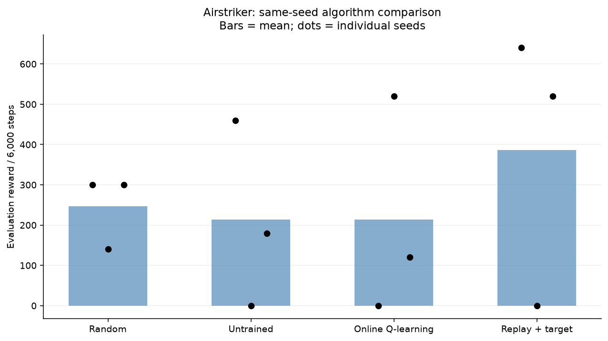
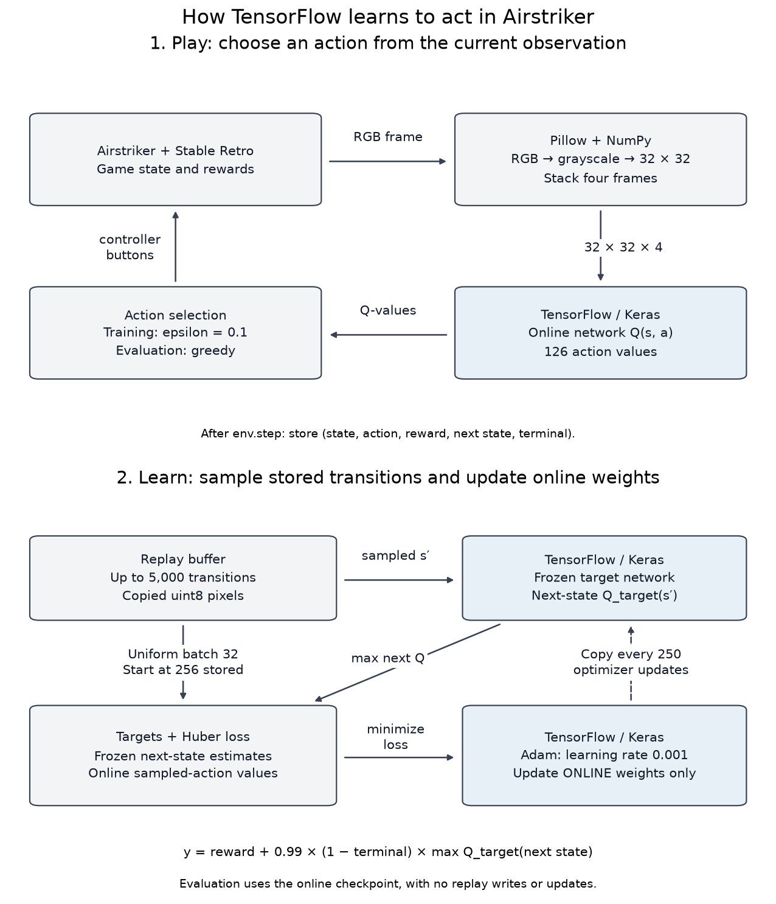
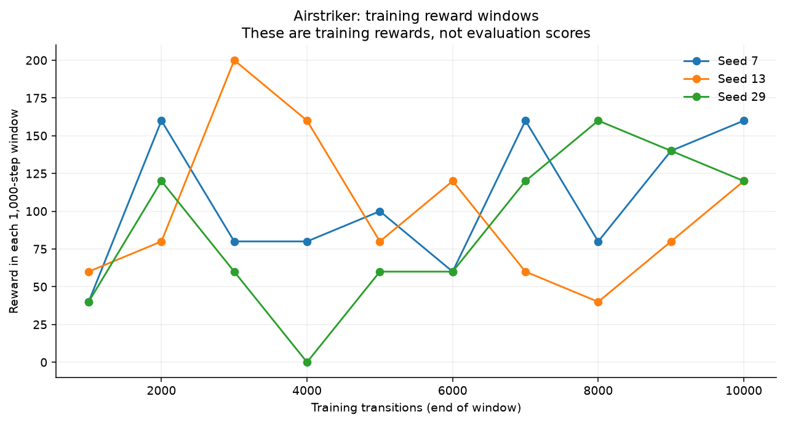
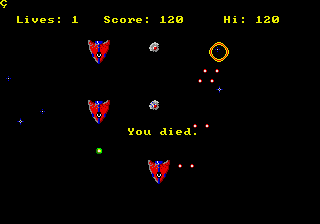
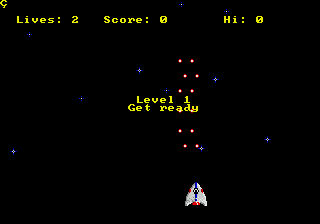
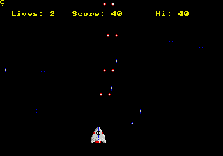
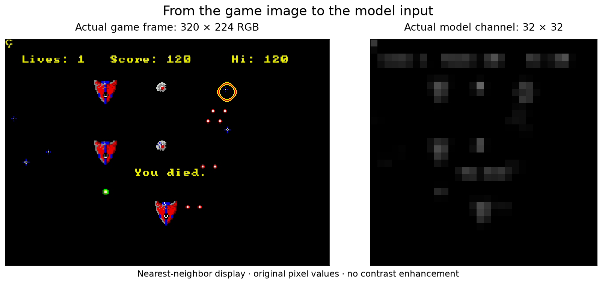

# Replay-buffer and target-network DQN — 2026-11-16

## Result

The replay/target agent earned **640, 0 and 520** points for seeds 7/13/29 in equal **6,000-step evaluations**. The re-run random baseline earned **300, 140 and 300**; the earlier online learner earned **0, 520 and 120**. Mean returns were **386.67 for DQN**, **246.67 for random**, and **213.33 for the earlier learner**.

This is an observed increase of **140 points over random** and **173.33 over the earlier learner**, with two wins and one loss against random. Seed 13 still failed completely and regressed from the earlier learner. Three training seeds and one fixed starting savestate do not establish statistical significance, convergence or unseen-level generalization.



Bars show means and dots show every seed, without confidence-interval claims. [SVG](algorithm-comparison.svg). The random and untrained policies were actually re-run; all six resulting control traces reproduced the previous traces **byte-for-byte**. [Control trace audit](control-reproduction.json).

## What changed

- Uniform replay capacity: **5,000 transitions**. Stored state/next-state pixel arrays are copied and encoded as uint8, then decoded to normalized float32 for learning.
- Minibatch: **32**, sampled without replacement within each batch; transitions can be sampled again across updates. Replay and exploration use separate seeded generators.
- Warmup: learning begins once **256 transitions** are stored; the first 255 collection steps do not optimize.
- Frozen target: initialized from online weights, used for next-state predictions and copied from online every **250 optimizer updates**. It receives no gradient updates.
- Each 10,000-step training run performed **9,745 minibatch updates**, sampled **311,840 transition entries**, and copied the target **38 times**. Final replay held 5,000 entries and **40,960,000 pixel bytes**, excluding Python/model/optimizer overhead.
- Huber metric state is reset before each update. New loss averages are actual returned minibatch losses; old loss values averaged running Keras metrics and should not be compared as convergence measures.

The CNN, observations (32×32 grayscale/four frames), 126-action space, Adam 0.001, gamma 0.99, constant training epsilon 0.1, greedy evaluation, game/ROM/default savestate and seeds stayed fixed. Training still performs one optimizer update per collection step after warmup. The interaction budget matches the earlier experiment; compute and replayed-sample budgets do not. Replay and target estimates changed together, so their individual contributions are not isolated.

## How TensorFlow fits into the game



[Scalable diagram](../../../images/airstriker-dqn-flow.svg). Stable Retro supplies observations and rewards; Pillow/NumPy preprocess them. TensorFlow/Keras runs the online and frozen networks and differentiates the online minibatch loss. Periodic target copying is a separate operation. Evaluation uses the online checkpoint without replay writes or weight updates.

The target is `reward + 0.99 × (1 - true_terminal) × max Q_target(next_state)`. True terminals stop bootstrapping; time-limit truncations retain it. These mechanisms follow the DQN ideas in [Mnih et al. (2015)](https://doi.org/10.1038/nature14236); this small experiment is not a reproduction of the paper’s Atari performance.

## Protocol and reproduction

- Fresh independent training seeds: **7, 13, 29**.
- Training: **10,000 transitions per seed**. Random, untrained and checkpoint evaluations: **6,000 each per seed**.
- Actual total: **84,000 transitions**, consisting of 30,000 training and 54,000 evaluation/control transitions.
- Each phase resets the same `Airstriker-Genesis-v0` default `Level1` savestate. Episode-reset seeds increment, but the starting game state remains fixed.
- CPU on macOS Apple Silicon; no GPU/cloud training, new ROM download, frame skipping, action-repeat wrapper, reward shaping, target tuning or evaluation-seed selection.
- Source was frozen at the clean commit recorded in [provenance](provenance.json) before running. Only analysis/documentation tooling changed during collection.

```sh
python examples/retro_experiment.py \
  --output runs/airstriker-dqn-reproduction \
  --seeds 7 13 29 --train-steps 10000 --evaluate-steps 6000 \
  --capture-every 1000 --replay-capacity 5000 --batch-size 32 \
  --learning-starts 256 --target-sync-interval 250
```

Use a new output directory. Smaller default experiments use 512 training steps; the synthetic smoke explicitly reduces its warmup so it performs five updates during eight collection steps. The longer run above is opt-in.

Regenerate analysis and all comparison plots without training:

```sh
python -m pip install -e '.[report]'
python examples/analyze_experiment.py \
  --source docs/experiments/2026-11-16-airstriker-dqn \
  --previous docs/experiments/2026-11-16-airstriker-long \
  --output runs/dqn-analysis --window 1000
```

The analyzer requires matching game, seeds and train/evaluation step budgets before comparing algorithms. It discloses whether random and untrained controls reproduced. The optional Matplotlib dependency produces static PNG/SVG artifacts.

## Every seed, including the failure

### Seed 7

- Random: **300**; untrained: **460**; earlier online learner: **0**; DQN: **640**.
- DQN minus random: **+340**; DQN minus earlier online: **+640**.
- Training reward: **1060**, with 6 complete episodes. DQN evaluation completed 4 episodes and used 34 distinct actions.
- Finite training diagnostics: loss 0.000951386879, online parameter L2 change 22.9825.

### Seed 13

- Random: **140**; untrained: **0**; earlier online learner: **520**; DQN: **0**.
- DQN minus random: **-140**; DQN minus earlier online: **-520**.
- Training reward: **1000**, with 5 complete episodes. DQN evaluation completed 4 episodes and used 23 distinct actions.
- Finite training diagnostics: loss 0.000942678744, online parameter L2 change 21.9014.

### Seed 29

- Random: **300**; untrained: **180**; earlier online learner: **120**; DQN: **520**.
- DQN minus random: **+220**; DQN minus earlier online: **+400**.
- Training reward: **880**, with 5 complete episodes. DQN evaluation completed 4 episodes and used 8 distinct actions.
- Finite training diagnostics: loss 0.000904276059, online parameter L2 change 24.3572.

The DQN seed-population standard deviation was **277.77**, versus **75.42** for random. These are descriptive variation measures, not confidence intervals. The improved sample mean coexists with a zero-return policy.

## Complete episodes and unfinished tails

Headline returns sum the entire fixed evaluation budget, including the unfinished final episode. Per-seed DQN episode returns were:

- Seed 7: completed returns [160.0, 160.0, 160.0, 160.0]; completed lengths [1460, 1460, 1460, 1460]; unfinished tail `{"return": 0.0, "length": 160}`.
- Seed 13: completed returns [0.0, 0.0, 0.0, 0.0]; completed lengths [1399, 1399, 1399, 1399]; unfinished tail `{"return": 0.0, "length": 404}`.
- Seed 29: completed returns [120.0, 120.0, 120.0, 120.0]; completed lengths [1370, 1370, 1370, 1370]; unfinished tail `{"return": 40.0, "length": 520}`.

All four completed greedy episodes within each DQN seed repeated the same return and length. This is expected under a deterministic policy resetting the same fixed savestate. **Those repeated episodes are not additional independent trials.** The independent training-seed count remains three. All 12 run details, including controls/training tails, are retained in [analysis.json](analysis.json).

## Training windows



[SVG](training-rewards.svg). Each point sums 1,000 observed training transitions. Training rewards were 1,060, 1,000 and 880. Positive training reward still did not guarantee useful greedy evaluation: seed 13 scored zero. The chart is not a held-out evaluation or convergence curve.

## New game images and a readable model-input view

### Seed 7, evaluation step 4,000



The displayed score is **120 in the current episode**. The final 6,000-step return is **640 across resets**. A single scoreboard is not the accumulated evaluation metric. This frame was selected for a readable gameplay illustration; metrics include the full run.

### Failed seed 13, evaluation step 6,000



This seed earned zero despite positive training reward and many distinct actions. The result is preserved rather than omitted.

### Seed 29, evaluation step 6,000



The displayed score is 40; the complete fixed-budget return was 520 across resets.

### See what the model receives



[Exact 12× pixel enlargement](../../../images/airstriker-observation-comparison-pixels.png). The previous 128-pixel browser-scaled thumbnail was too small and blurred. This view uses nearest-neighbor enlargement with unchanged intensities, no contrast enhancement and a matching original frame. The underlying input remains 32×32 and the model receives four temporal channels; display enlargement does not restore lost detail or change preprocessing.

## Evidence, validation and limits

- [Original manifest](manifest.json), [computed analysis](analysis.json) and [algorithm comparison](comparison.json).
- [Provenance](provenance.json): original training-source/ROM hashes, clean source revision and hashes of unpublished local checkpoints.
- [Control reproduction](control-reproduction.json) and [trace integrity](trace-integrity.json): exact comparisons and compressed/uncompressed hashes.
- Twelve `seed-<seed>-<phase>/transitions.jsonl.gz` files preserve every actual transition; compression is lossless with fixed timestamps.
- **312 native/processed gameplay PNGs** are retained, alongside three PNG/three SVG analysis figures. Featured-image [provenance](image-provenance.json) identifies their source captures.
- [Artifact hashes](artifact-sha256.json), [execution output](execution.txt), [offline tests](offline-tests.txt) and pinned [requirements](requirements.lock) support audit/reproduction.
- Offline tests verify replay eviction/copying/sampling, seeded batches, warmup counters, target isolation/synchronization, terminal targets and a known numerical Keras loss proving frozen-target use. Analysis tests reject incompatible protocols and disclose changed controls.
- Tests use synthetic arrays/fixtures and are explicitly separate from these real emulator measurements. No test passing or coverage badge is fabricated.
- The sample is small, uses one fixed savestate and changes replay/target mechanisms together. Mean improvement here is not a general performance guarantee. Further ablations and unseen-state evaluation remain future work.
- Saved `.keras` models contain online model/optimizer state. Replay contents, delayed target weights, environment/RNG state and frame history are not persisted; exact training continuation is unsupported.
- No ROM or checkpoint is published. Airstriker imagery retains its owners’ rights and the included ROM is provided upstream for non-commercial testing; it is not relicensed under the source-code MIT license.

Summed measured rollout time was **279.00 seconds**. It includes gameplay, inference/updates and recording, excludes model construction/loading and final checkpoint saving, and overlapped local tooling. It is not a controlled timing benchmark.
