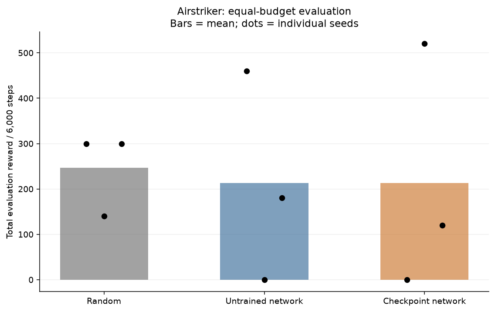
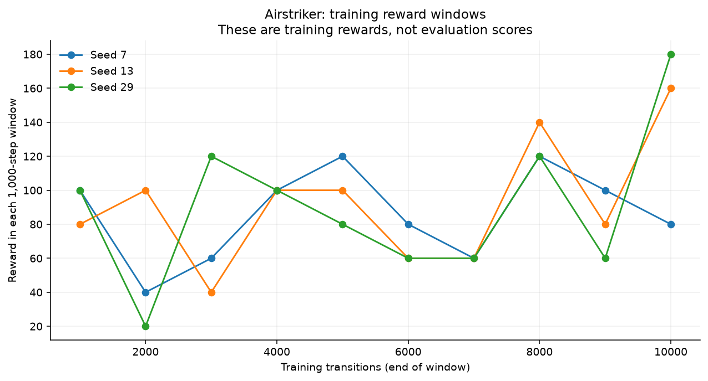
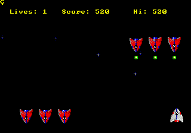
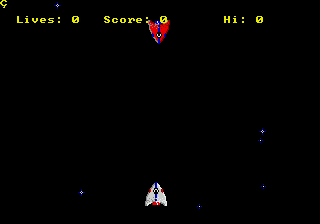
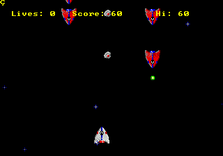

# Airstriker: longer training versus a random agent

Experiment date: 2026-11-16. Game: `Airstriker-Genesis-v0`, default `Level1` savestate.

## Main result

Three independently initialized networks received **10,000 training transitions each**. In equal-budget **6,000-step evaluations**, checkpoint rewards were **0, 520, 120**, while the random baseline earned **300, 140, 300** (seeds 7/13/29). Mean checkpoint reward was **213.33**, versus **246.67** for random: a descriptive difference of **-33.33 points (-13.51%)**.

Only one of the three checkpoints beat its corresponding random baseline. This longer run **does not demonstrate a consistent advantage over random actions**. The mixed outcome and complete failure in seed 7 are retained, rather than selecting only the successful seed. No statistical significance, convergence or strong-gameplay claim is made.



Bars show seed means; black dots show individual seeds. They are not confidence intervals. [SVG version](evaluation-comparison.svg).

## What changed, and what stayed fixed

- Training increased from 128 to 10,000 transitions per seed: **78.125× the earlier smoke budget**.
- Seeds remained 7, 13 and 29; each network started fresh, independently of the earlier smoke checkpoints.
- Each random, untrained and checkpoint evaluation received the same 6,000-transition budget. The earlier 256-step smoke scores are not directly comparable to these 6,000-step totals.
- The model and algorithm were unchanged: 32×32 grayscale/four-frame input, 17,542 parameters, 126 filtered discrete actions, Adam 0.001, Huber loss, gamma 0.99, training epsilon 0.1 and greedy evaluation.
- No replay buffer, target network, tuned action subset, frame skipping, action repetition or reward shaping was introduced.
- Training and evaluation both use the same default savestate. Seeds vary initialization/exploration/random actions; they are not held-out levels or proof of unseen-state generalization.
- CPU execution on macOS Apple Silicon. No cloud/GPU training or new ROM acquisition occurred.

## Reproduce the experiment

Install the pinned development environment from the README, then explicitly request the longer budget:

```sh
python examples/retro_experiment.py \
  --output runs/airstriker-long-reproduction \
  --seeds 7 13 29 \
  --train-steps 10000 \
  --evaluate-steps 6000 \
  --capture-every 1000
```

Use a new output directory. Training is opt-in; normal smoke commands retain their small defaults. Runtime varies by machine. The original local output remains under `runs/airstriker-long-2026-11-16-10k/`; checkpoints are intentionally excluded from Git.

For a fresh analysis of the published compressed traces:

```sh
python -m pip install -e '.[report]'
python examples/analyze_experiment.py \
  --source docs/experiments/2026-11-16-airstriker-long \
  --output runs/airstriker-long-analysis \
  --window 1000
```

This reads `.jsonl` or `.jsonl.gz`, verifies step/reward totals against the manifest, distinguishes complete episodes from the unfinished tail, and writes JSON plus PNG/SVG figures. It performs no training. On restricted hosts, use writable `MPLCONFIGDIR` and `XDG_CACHE_HOME` directories. The reporting extra pins Matplotlib 3.11.2; it is optional for gameplay.

## Per-seed comparison

### Seed 7

- Random: **300** reward; 3 completed episodes.
- Untrained greedy network: **460**; 4 completed episodes.
- Training (10,000 steps): **860**; 4 completed episodes.
- Checkpoint greedy evaluation: **0**; 4 completed episodes.
- Checkpoint minus random: **-300** points.
- Checkpoint used 1 distinct actions; most frequent index 45 occurred 6,000/6,000 times.

### Seed 13

- Random: **140** reward; 3 completed episodes.
- Untrained greedy network: **0**; 4 completed episodes.
- Training (10,000 steps): **920**; 6 completed episodes.
- Checkpoint greedy evaluation: **520**; 0 completed episodes.
- Checkpoint minus random: **+380** points.
- Checkpoint used 10 distinct actions; most frequent index 71 occurred 4,196/6,000 times.

### Seed 29

- Random: **300** reward; 4 completed episodes.
- Untrained greedy network: **180**; 2 completed episodes.
- Training (10,000 steps): **900**; 5 completed episodes.
- Checkpoint greedy evaluation: **120**; 1 completed episodes.
- Checkpoint minus random: **-180** points.
- Checkpoint used 3 distinct actions; most frequent index 80 occurred 5,863/6,000 times.

The untrained-network mean was also **213.33**. The checkpoint mean did not exceed that control in this sample. Population standard deviations across the three seed totals were random **75.42**, untrained **189.27**, checkpoint **222.31**. These describe observed seed variation and are not estimates of confidence in a general performance claim.

## Training rewards are not evaluation results



[SVG version](training-rewards.svg). Each point sums the rewards actually observed in one training window; it is not an intermediate evaluation. Training earned 860, 920 and 900 points, with 15 completed episodes in total. All final recorded loss/weight-change diagnostics were finite. Positive training rewards and changing weights did not guarantee a useful greedy policy.

Seed 7 selected action index 45 on all 6,000 greedy evaluation steps and earned zero reward. This is an observed action-pattern failure. The data do not identify a unique cause. Correlated online updates, bootstrapped estimates, sparse rewards, aggressive downsampling and the broad action space are plausible follow-up hypotheses, not experimentally established explanations.

The `loss` field is the mean of the values returned by Keras `train_on_batch` during the rollout. Those values can be running metric aggregates; do not interpret this diagnostic as a per-transition loss curve or evidence of convergence.

## Complete episodes versus an unfinished tail

The headline metric is total reward per fixed evaluation budget, including the final incomplete episode. It is not mean episodic return. Ending collection after 6,000 steps does not set the game's `truncated` flag: the collector stops, while the remaining episode is recorded as unfinished.

Episode accounting from the raw traces:

- Seed 7, **random**: completed returns [0, 40, 200]; unfinished tail: 60 reward over 1,452 steps.
- Seed 7, **untrained**: completed returns [100, 100, 100, 100]; unfinished tail: 60 reward over 424 steps.
- Seed 7, **train**: completed returns [300, 200, 120, 240]; unfinished tail: 0 reward over 623 steps.
- Seed 7, **trained**: completed returns [0, 0, 0, 0]; unfinished tail: 0 reward over 1,152 steps.
- Seed 13, **random**: completed returns [0, 100, 0]; unfinished tail: 40 reward over 1,086 steps.
- Seed 13, **untrained**: completed returns [0, 0, 0, 0]; unfinished tail: 0 reward over 640 steps.
- Seed 13, **train**: completed returns [120, 100, 160, 100, 160, 220]; unfinished tail: 60 reward over 812 steps.
- Seed 13, **trained**: completed returns [none]; unfinished tail: 520 reward over 6,000 steps.
- Seed 29, **random**: completed returns [80, 100, 20, 100]; unfinished tail: 0 reward over 143 steps.
- Seed 29, **untrained**: completed returns [80, 80]; unfinished tail: 20 reward over 528 steps.
- Seed 29, **train**: completed returns [160, 180, 180, 140, 180]; unfinished tail: 60 reward over 294 steps.
- Seed 29, **trained**: completed returns [80]; unfinished tail: 40 reward over 1,860 steps.

Seed 13's checkpoint collected all 520 points in a single unfinished 6,000-step episode. Its completed-episode mean is therefore undefined, not 520 and not zero. Pooling that run with other completed episodes would hide this distinction. The analyzer tests explicitly check terminal, truncated and unfinished cases.

## New gameplay captures

### Checkpoint, seed 13, step 6,000



This is the successful seed, included with the failure below. The displayed score 520 equals its total evaluation reward because no episode completed. It is not representative of the mean across all three seeds.

### Checkpoint failure, seed 7, step 6,000



Zero evaluation reward and four completed episodes are retained in the comparison.

### Random baseline, seed 7, step 6,000



The current screenshot shows score **60**, while cumulative evaluation reward was **300** across completed episodes plus the unfinished tail. A screenshot of the current score is not a replacement for trace-based accounting.

### Corresponding processed channel


The model receives four such temporal channels. This preview is the latest channel from the successful capture, enlarged only by the document renderer. All new images are emulator observations, with no generated gameplay or overlays.

## Evidence and integrity

The full experiment contains **84,000 transitions**: **30,000 training** and **54,000 evaluation/control** transitions. There are 148 capture points and 296 native/processed gameplay PNGs, plus the analysis figures.

- [Original manifest](manifest.json): configuration, versions, timings, captures and all 12 summaries.
- [Computed analysis](analysis.json): all seed totals, complete-episode returns, unfinished tails and training windows.
- [Provenance](provenance.json): clean starting Git revision, source hashes, integration scenario, verified ROM hash and hashes of local unpublished checkpoints.
- [Trace integrity](trace-integrity.json): hashes of each gzip file and its exact uncompressed original. Compression uses a fixed timestamp; measurements are not altered.
- Each `seed-<seed>-<phase>/transitions.jsonl.gz` contains the original per-step JSON records, compressed to keep the repository manageable. `gzip.open(path, "rt")` reads them directly.
- [Execution output](execution.txt) and [offline test log](offline-tests.txt) retain actual diagnostics. No warning was suppressed.
- [Pinned reporting environment](requirements.lock) records the optional plotting dependencies as well as runtime/test packages.
- [Artifact hashes](artifact-sha256.json) cover the exported data/figures. Four README images are byte-for-byte copies of selected capture files; source capture paths are recorded in image provenance.

Summed measured rollout time was **260.71 seconds**. This includes gameplay, inference/updates, trace writing and captures, excludes model initialization/loading and final checkpoint saving, and overlapped local validation/report preparation. It is not a controlled speed benchmark.

## What can and cannot be concluded

- Longer collection reached real episode boundaries and positive training rewards, extending the earlier pipeline-only smoke evidence.
- This configuration did not reliably outperform random actions or the untrained control: one seed improved strongly, two lost against random, and the mean was lower than random.
- Three training seeds and one fixed-budget evaluation per policy/seed are a limited sample. No confidence interval or significance test is asserted.
- The same savestate was used for training and evaluation. There is no held-out level, unseen-state evaluation, solved-game claim or generalization result.
- Full-episode metrics and partial tails are disclosed rather than silently mixed.
- The unchanged minimal algorithm lacks replay and a target network. Improving it requires a separate controlled experiment, rather than tuning after seeing these evaluation results and presenting the tuned result as this run.
- No ROM or model weights are published. Airstriker imagery retains its owners' rights; the ROM is supplied upstream for non-commercial testing, and is not relicensed under the repository's MIT source-code license.
