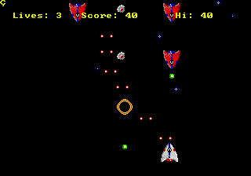
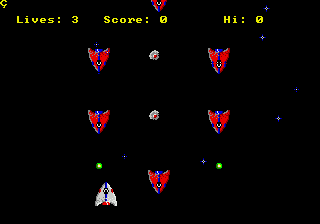
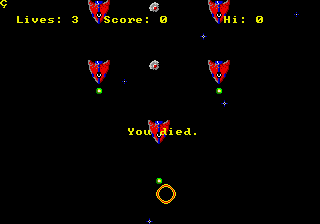
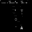

# Airstriker real-emulator experiment — 2026-11-16

## Finding

The TensorFlow pipeline ran successfully against a real Stable Retro emulator using the included Airstriker ROM. All 12 bounded runs completed, produced traceable images and rewards, and saved/loaded local checkpoints. This is an integration smoke experiment, not a trained Mario demonstration or an established learning result.

## Game selection and provenance

Airstriker by Electrokinesis is a Sega Genesis shooter supplied by Stable Retro for non-commercial testing. Its selection follows the [official upstream README](https://github.com/Farama-Foundation/stable-retro) and [included-ROM list](https://github.com/Farama-Foundation/stable-retro/blob/main/docs/included_roms.md). No commercial ROM-download site was used. The already-installed package supplied the test ROM; no ROM binary is copied into this repository.

The actual ROM SHA-1 matched the integration reference: `a8be7b0ca850119b167f9644e6a4a22e983d61a4`. The default savestate is `Level1`. The integration rewards increases in its `score` variable. Its terminal rule requires both `gameover == 1` and zero `lives`. No artificial time-limit wrapper was installed. A visible death message therefore does not necessarily represent a completed episode.

Airstriker is a different game and platform from Super Mario World. Mario integration remains untested because no authorized Nintendo ROM was supplied. Screenshots below are actual emulator observations from this execution; historical Mario screenshots and synthetic fixtures are not used as evidence.

## Configuration and method

```sh
python examples/retro_experiment.py \
  --output docs/experiments/2026-11-16-airstriker/run \
  --seeds 7 13 29 \
  --train-steps 128 \
  --evaluate-steps 256 \
  --capture-every 128
```

For reproduction, use a fresh output directory such as `runs/airstriker-reproduction`: the evidence directory above already exists and is deliberately protected from overwrite.

- Three explicit seeds: 7, 13 and 29.
- For each seed: random-policy evaluation (256 steps), fresh greedy network evaluation (256), fresh epsilon-greedy training (128), then greedy evaluation of the saved/reloaded network (256).
- All phases reset the same integration default state and seed. The untrained and training networks start from the same model seed.
- Input: actual 224×320 RGB frames; grayscale resize to 32×32; normalization to [0, 1]; four-frame stack.
- Full filtered discrete action space: 126 button combinations. No frame skipping, action repeat, reward shaping or OCR.
- Keras model: 17,542 parameters; Adam 0.001; Huber loss; gamma 0.99; training epsilon 0.1; evaluation epsilon 0.
- CPU only on macOS Apple Silicon; no GPU devices were available.

Package versions in the executed manifest: tensorflow 2.21.0, keras 3.15.1, numpy 2.5.5, Pillow 13.0.0, stable-retro 1.0.1.
Python 3.13.18; platform `macOS-27.2.1-arm64-arm-64bit-Mach-O`. UTC creation timestamp: `2026-11-16T03:42:36.997451+00:00`.

## Collected results

- **Random baseline:** rewards 0, 0, 0 for seeds 7/13/29; mean 0.00; 768 total transitions.
- **Untrained greedy network:** rewards 20, 0, 0 for seeds 7/13/29; mean 6.67; 768 total transitions.
- **Short training window:** rewards 0, 0, 0 for seeds 7/13/29; mean 0.00; 384 total transitions.
- **Checkpoint greedy evaluation:** rewards 20, 40, 40 for seeds 7/13/29; mean 33.33; 768 total transitions.

Every training run received zero positive rewards. Parameters still changed because the online update bootstraps from predicted next-state Q-values. Evaluation scores after these updates were higher for two seeds, but this small uncontrolled sample does not demonstrate robust reward-driven learning. Different greedy action sequences, initialization, correlated observations and sparse rewards can all affect these short outcomes.

Individual run diagnostics:

- Seed 7, **random**: reward 0; 256 steps; 113 distinct actions; 0 nonzero rewards; final integration variables `{"gameover": 2, "lives": 3, "score": 0}`.
- Seed 7, **untrained**: reward 20; 256 steps; 12 distinct actions; 1 nonzero rewards; final integration variables `{"gameover": 9, "lives": 3, "score": 20}`.
- Seed 7, **train**: reward 0; 128 steps; 20 distinct actions; 0 nonzero rewards; final integration variables `{"gameover": 9, "lives": 3, "score": 0}`; loss 1.24889953e-06; parameter L2 change 0.290555.
- Seed 7, **trained**: reward 20; 256 steps; 14 distinct actions; 1 nonzero rewards; final integration variables `{"gameover": 9, "lives": 3, "score": 20}`.
- Seed 13, **random**: reward 0; 256 steps; 106 distinct actions; 0 nonzero rewards; final integration variables `{"gameover": 9, "lives": 3, "score": 0}`.
- Seed 13, **untrained**: reward 0; 256 steps; 5 distinct actions; 0 nonzero rewards; final integration variables `{"gameover": 9, "lives": 3, "score": 0}`.
- Seed 13, **train**: reward 0; 128 steps; 19 distinct actions; 0 nonzero rewards; final integration variables `{"gameover": 9, "lives": 3, "score": 0}`; loss 2.21790447e-06; parameter L2 change 0.341629.
- Seed 13, **trained**: reward 40; 256 steps; 11 distinct actions; 2 nonzero rewards; final integration variables `{"gameover": 9, "lives": 3, "score": 40}`.
- Seed 29, **random**: reward 0; 256 steps; 109 distinct actions; 0 nonzero rewards; final integration variables `{"gameover": 1, "lives": 3, "score": 0}`.
- Seed 29, **untrained**: reward 0; 256 steps; 19 distinct actions; 0 nonzero rewards; final integration variables `{"gameover": 9, "lives": 3, "score": 0}`.
- Seed 29, **train**: reward 0; 128 steps; 18 distinct actions; 0 nonzero rewards; final integration variables `{"gameover": 9, "lives": 3, "score": 0}`; loss 1.23882034e-06; parameter L2 change 0.263649.
- Seed 29, **trained**: reward 40; 256 steps; 15 distinct actions; 2 nonzero rewards; final integration variables `{"gameover": 9, "lives": 3, "score": 40}`.

Across all runs: **2,688 transitions**, zero completed episodes, zero truncations, 45 capture points and **90 PNG files** (RGB plus processed preview). The complete serialized manifest is [available here](run/manifest.json).

Summed measured rollout time was 9.794 seconds. Timing includes inference/updates, trace writing and screenshots; it excludes model initialization/loading and final checkpoint saving. This is an observation of one local execution, not a reproducible throughput benchmark.

## Captured evidence

### Seed 13: greedy evaluation after short training, step 256



The frame and the trace both report score 40. This is an in-game score observation, not a level-completion claim.

### Seed 13: untrained greedy policy, step 256



### Seed 7: random policy, step 256



### Actual preprocessed input channel



This image is the latest grayscale channel, enlarged only by the document renderer. The model receives four consecutive channels. RGB screenshots are saved at native resolution without decorative overlays or generated imagery.

## Evidence files and reproduction

- [Manifest](run/manifest.json): configuration, versions and all 12 summaries.
- [Execution output](execution.txt): original runner output and TensorFlow diagnostics.
- [Provenance](provenance.json): ROM hash, integration data, source hashes and starting Git revision.
- [Artifact SHA-256 hashes](artifacts-sha256.json): evidence integrity; local checkpoints are included in this hash list but are intentionally excluded from Git.
- [Dependency changes](dependency-updates.json), [old environment](requirements-before.lock) and [new environment](requirements-after.lock): update audit trail.
- Each `run/seed-<seed>-<phase>/transitions.jsonl` contains per-step action, reward, terminal flags and integration variables. The reset record identifies its seed.
- Each phase directory contains the sampled RGB and processed PNGs referenced by the manifest. Local `run/seed-<seed>.keras` checkpoints permit evaluation on this machine; no weights are published.

From the repository root, after installing the lock, a local checkpoint can be evaluated using:

```sh
mario-tf evaluate --env retro --game Airstriker-Genesis-v0 \
  --steps 256 --seed 13 \
  --checkpoint docs/experiments/2026-11-16-airstriker/run/seed-13.keras
```

Fresh clones should regenerate checkpoints with the experiment command. They are not committed.

## Validation and limitations

- Before updates: 14 offline tests passed.
- After dependency updates and new recording/orchestration tests: 24 offline tests passed, 97% statement coverage. The real emulator experiment is a separate manual integration validation, not part of that offline coverage claim.
- Lint, formatting, dependency consistency and wheel/source-distribution builds passed locally. The experiment was initially validated locally; after publication, the offline suite, synthetic smoke and build also passed on Ubuntu in [GitHub Actions](https://github.com/kleberandrade/mario-tensorflow/actions/runs/43800722748). The real emulator experiment itself remains macOS-only.
- CRAP remained below 10 for every function; dryer found no source duplicate candidates at similarity 0.8. Mutation testing of the recorder reported 24 selected mutations killed, with no survivors; this is not a repository-wide mutation score.
- Eighteen Keras/NumPy serialization deprecation warnings remain in the offline suite. TensorFlow CPU-profiling diagnostics remain in the real-run output. None were suppressed.
- h5py 3.14.0 and pyglet 1.5.31 remain constrained by TensorFlow and Stable Retro. All other installed packages were current according to the index check made during this task.
- No full episode finished. There are only three seeds, 128 training steps per seed and 256 evaluation steps per policy. No statistical significance, convergence, generalization or Mario performance is asserted.
- After this experiment was recorded, the user authorized publication to `master`. The [offline GitHub Actions run passed](https://github.com/kleberandrade/mario-tensorflow/actions/runs/43800722748); no deployment was performed.

## Asset notice

Airstriker game content and screenshots retain their owners’ rights. Upstream supplies the ROM for non-commercial testing; no broader license, public-domain status or MIT relicensing is inferred. This repository includes screenshots and measurements as test documentation, not a ROM binary. Emulator cores retain [their upstream licenses](https://github.com/Farama-Foundation/stable-retro/blob/main/LICENSES.md).
